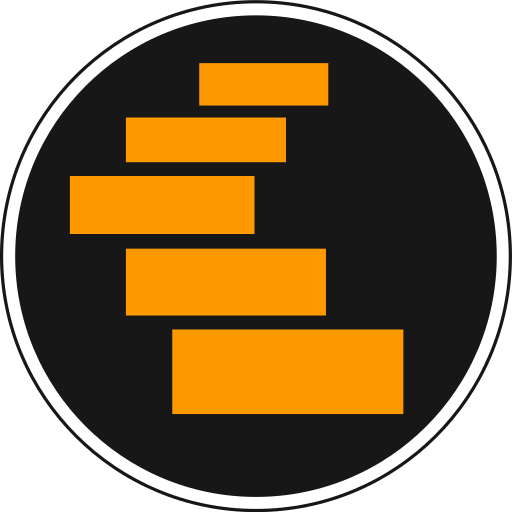

<p align="center">
  
</p>

<h1 align="center">TCP-TRIP</h1>

<p align="center">
  Plataforma educativa bilingüe (español / inglés) para aprender redes de computadores recorriendo el modelo TCP/IP capa por capa.
</p>

---

## ¿Qué es?

TCP-TRIP es una aplicación web para estudiantes universitarios de redes. Permite explorar la teoría del modelo TCP/IP, resolver cálculos de cabeceras y direccionamiento con herramientas que muestran el procedimiento, diseñar protocolos propios sobre un diagrama estilo RFC y practicar con ejercicios generados. Los profesores preparan y proyectan material de clase, arman talleres en PDF y los asignan por Google Classroom; los administradores validan a los profesores y revisan lo que se publica.

**Problema que resuelve.** Los RFC son densos y difíciles de leer sin contexto visual, y las herramientas existentes (Wireshark, calculadoras de subredes en línea) están pensadas para profesionales, no para el aprendizaje guiado.

**Propósito central: optimizar el tiempo del profesor.** Cada funcionalidad busca que el estudiante resuelva por sí mismo las dudas fáciles y mecánicas (conversiones, cálculo de subredes, anchos de campo, ubicar un protocolo en su capa), para que el tiempo con el docente quede reservado a las dudas conceptuales que la aplicación no puede responder.

Dos principios que atraviesan toda la aplicación:

- **Los errores citan su estándar.** Cuando una herramienta rechaza una entrada por una regla de un estándar, el mensaje cita el RFC y la sección que la impone (RFC 791, 793, 1071, 1624, 2474, 3168…), para que el estudiante aprenda dónde vive la regla.
- **Toda herramienta con práctica genera ejercicios.** Las herramientas ofrecen la acción *Generar ejercicios*: un PDF descargable con dificultad, cantidad y hoja de respuestas opcional, sobre una plantilla institucional común (autor, universidad, director de trabajo de grado, numeración de páginas).

---

## Funcionalidades

### Herramientas (todos los usuarios)

| Herramienta | Qué hace | Ejercicios |
| --- | --- | :---: |
| **Conversor de bases numéricas** | Convierte entre binario, octal, decimal y hexadecimal con un teclado que solo admite dígitos válidos y longitud de resultado fija en dígitos. | ✓ |
| **Conversor ASCII** | Texto ↔ códigos por carácter en BIN/OCT/DEC/HEX, comparando el mismo flujo leído como ASCII de 8 bits o como UTF‑8. | ✓ |
| **Calculadora IPv4** | A partir de una dirección y su máscara calcula red, broadcast, máscara y subredes. | ✓ |
| **Fragmentación IPv4** | A partir de la longitud total y el MTU, muestra la cabecera original y cada fragmento sobre la rejilla de 32 bits del RFC 791: datos, offset en bloques de 8 bytes y bandera MF. | ✓ |
| **Checksum IPv4** | Calcula o verifica el checksum de una cabecera paso a paso: suma en complemento a uno, plegado del acarreo y complemento final (RFC 1071). | ✓ |

### Protocolo genérico

- **Constructor de protocolos**: diagrama de encabezado estilo RFC editable — campos libres, tipos arrastrados desde un catálogo y longitud en bits ajustada contra una regla redimensionable.
- **Persistencia y enlaces públicos**: los protocolos se guardan por usuario y se pueden compartir con un enlace de solo lectura (`/protocol/shared/<id>`).
- *Mis protocolos* y *Mensajes* (componer mensajes estructurados con los encabezados guardados) están registrados en la navegación y en desarrollo.

### Teoría

- **Lector de presentaciones** con dos vistas —lectura por desplazamiento y modo presentación— que comparten un mismo **porcentaje de avance** por estudiante, monotónico y con punto de reanudación.
- **Menú de Teoría curado**: las secciones de la barra lateral no están en el código; las crea un administrador y les asigna presentaciones aprobadas, en el orden en que se enseña el curso.
- **Teoría base del modelo TCP/IP**: el modelo y sus cuatro capas (enlace, internet, transporte, aplicación), cada una con lectura y diapositivas, publicables con un script de *seed*.

### Panel del profesor

- **Editor de presentaciones** con dos modos: lienzo libre de diapositivas (texto, imagen, tabla y formas, con manejadores para escalar y rotar) o escritura en Markdown. Las notas del autor nunca llegan al estudiante.
- **Flujo de revisión**: el profesor envía su borrador a revisión, puede retirarlo y lee el motivo si se rechaza; las ediciones posteriores vuelven a revisión.
- **Modo presentación** a pantalla completa, pensado para proyector, con acciones comunes (exportar, preguntar, reportar, tablero) y notas visibles solo para el autor.
- **Crear ejercicios**: talleres que combinan bloques de varias herramientas, cada uno con su dificultad, guardados *congelados* para que volver a descargar el PDF dé exactamente lo que recibieron los estudiantes.
- **Google Classroom**: conexión incremental desde el panel (los permisos no se piden al registrarse), *Mis cursos* (cursos, estudiantes, tareas y entregas) y *Asignar* (tareas y anuncios con los PDF de ejercicios y enlaces a presentaciones publicadas adjuntos). TCP-TRIP solo modifica los elementos de Classroom que él mismo creó.

### Panel del administrador

- **Revisión de presentaciones**: aprobar (se congela una copia del documento, sin notas privadas, con un *slug* estable) o rechazar con motivo obligatorio. Cada acción queda en un registro de auditoría.
- **Constructor del menú de Teoría**: secciones con nombre e icono y las presentaciones aprobadas que contiene cada una.
- *Usuarios* y *Validación de profesores* están registrados en la navegación y en desarrollo; mientras tanto el rol se asigna desde el dashboard de Clerk (ver [`docs/users/roles.md`](docs/users/roles.md)).

### Experiencia de uso

- **Pestañas tipo navegador**: cada página de la barra lateral abre una pestaña que conserva su estado mientras está abierta, con historial atrás/adelante propio y migas de pan.
- **Bilingüe**: toda la interfaz en español e inglés.
- **Tema claro y oscuro**.
- **Acciones por herramienta** en la esquina superior derecha del contenido (p. ej. *Generar ejercicios*).

---

## Roles

| Rol | Propósito | Cómo se obtiene |
| --- | --- | --- |
| **Estudiante** | Aprender y practicar de forma autónoma. | Rol por defecto al registrarse. |
| **Profesor** | Preparar material, evaluar y acompañar al curso. | Lo concede un administrador tras validar que es docente. |
| **Administrador** | Gestionar usuarios, validar profesores y moderar contenido. | Asignado a mano en Clerk. |

El rol vive en `publicMetadata.role` de Clerk y viaja dentro del token de sesión; **el servidor lo verifica en cada petición**. Ocultar una entrada en la barra lateral es solo cosmético. Detalle en [`docs/users/roles.md`](docs/users/roles.md).

---

## Stack

| Capa | Tecnología |
| --- | --- |
| Runtime, servidor y bundler | [Bun](https://bun.sh) (`Bun.serve`, sin Vite ni Express) |
| Interfaz | React 19, React Router, TypeScript estricto |
| Componentes y estilos | shadcn/ui sobre Base UI, Tailwind CSS v4, Lucide, Montserrat y JetBrains Mono |
| Editor de diapositivas | Konva + react-konva (solo para editar; la lectura es DOM) |
| Contenido | markdown-to-jsx, highlight.js |
| Autenticación y roles | Clerk (`@clerk/clerk-react`, `@clerk/backend`) |
| Base de datos | SQLite con `bun:sqlite` (sin ORM) |
| PDF | PDFKit |
| i18n | i18next + react-i18next |
| Integraciones | Google Classroom y Google Drive (solo desde el servidor) |
| Despliegue | Docker + Railway |

---

## Puesta en marcha

### Requisitos

- [Bun](https://bun.sh) (no se usa npm, yarn, pnpm ni Node).
- Una aplicación de [Clerk](https://clerk.com).
- Opcional: un proyecto de Google Cloud con Classroom API y Drive API para el panel de cursos.

### Instalación

```sh
bun install
```

Crear un `.env` en la raíz (Bun lo carga solo):

```sh
PUBLIC_CLERK_PUBLISHABLE_KEY=pk_test_...   # se incrusta en el cliente
CLERK_SECRET_KEY=sk_test_...               # solo servidor, nunca con prefijo PUBLIC_
# Opcionales
DATABASE_PATH=data/tcp-trip.sqlite         # valor por defecto
APP_ORIGIN=https://mi-dominio              # enlaces adjuntos a Classroom detrás de un proxy
PORT=3000
```

En el dashboard de Clerk (*Sessions → Customize session token*) agregar `{ "metadata": "{{user.public_metadata}}" }` para que el rol viaje en el token. Para Google Classroom, seguir la sección *Configuración requerida* de [`docs/exercises/ClassroomIntegration.md`](docs/exercises/ClassroomIntegration.md).

### Comandos

```sh
bun run dev          # servidor de desarrollo con HMR (puerto 3000)
bun run start        # modo producción sin HMR
bun run build        # empaqueta servidor + SPA en dist/ (ejecutar: cd dist && bun index.js)
bun run typecheck    # tsc --noEmit
bun test             # todas las pruebas
bun test ruta/al/archivo.test.ts
bun run ui <componente>   # agrega un componente de shadcn
```

### Teoría base del modelo TCP/IP

Publica el modelo y sus cuatro capas por el flujo real (el profesor guarda y envía, el administrador aprueba en la sección *Modelo TCP/IP*). Es idempotente.

```sh
bun run seed:theory --teacher <id de Clerk> --admin <id de Clerk> --author "Nombre Apellido"
```

### HTTPS opcional

El servidor sirve HTTPS directamente si `TLS_KEY_PATH` y `TLS_CERT_PATH` apuntan a archivos PEM legibles (opcionales: `TLS_CA_PATH`, `TLS_PASSPHRASE`, `TLS_SERVER_NAME`). Sin ellas, sirve HTTP.

---

## Arquitectura

Un solo proceso Bun sirve la API (`/api/*`) y la SPA de React; no hay servidor de frontend aparte.

```
src/
├── api/          rutas del servidor, guardas de rol, contrato de respuestas, logs
├── components/   common/ (compartidos), layouts/ (shell y pestañas), ui/ (shadcn)
├── config/       árbol de navegación, i18n y traducciones, registro de herramientas con ejercicios
├── context/      providers de React (pestañas, tema, acciones, modo presentación)
├── db/           conexión SQLite, esquema, un dominio por carpeta (queries → DAO → repositorio), seeds
├── features/     una carpeta por herramienta o módulo, importada solo por su barrel
├── hooks/        hooks compartidos
├── lib/          lógica pura transversal: pestañas, PDF, ejercicios, contratos cliente/servidor
├── pages/        inicio, 404, protocolo compartido
└── services/     clientes de la API
```

Decisiones destacadas:

- **Una sola fuente de navegación** (`src/config/navigation.ts`): barra lateral, pestañas, migas de pan y el tipo `PagePath` se derivan de un mismo árbol; una ruta mal escrita es un error de compilación.
- **Funcionalidades aisladas**: una *feature* nunca importa a otra; lo compartido sube a `lib/`, `components/common/` o `hooks/`.
- **Sin librería de estado global**: estado local en cada herramienta (las pestañas inactivas siguen montadas), un reductor puro y probado para las pestañas, contextos acotados y la API para los datos del servidor.
- **La propiedad vive en el `WHERE`**: cada consulta de un dueño filtra por el id de Clerk verificado en el servidor; nunca se toma de la petición.
- **Contenido publicado congelado**: lo que lee el estudiante es una copia aprobada del documento, sin notas, independiente del borrador del profesor. Las imágenes de las diapositivas se guardan como BLOB en SQLite (el archivo de la base es todo el respaldo) y se rechaza SVG.

Las guías de cada área están en [`CLAUDE.md`](CLAUDE.md) y en `docs/`.

---

## Documentación

| Área | Documento |
| --- | --- |
| Roles | [`docs/users/roles.md`](docs/users/roles.md) |
| Navegación y pestañas | [`docs/ui/Navigation.md`](docs/ui/Navigation.md), [`docs/ui/Tab.md`](docs/ui/Tab.md) |
| Modo presentación | [`docs/ui/PresentationMode.md`](docs/ui/PresentationMode.md) |
| Conversores | [`docs/tools/converters/`](docs/tools/converters/) |
| Calculadoras | [`docs/tools/calculators/`](docs/tools/calculators/) |
| Constructor de protocolos | [`docs/generic-protocol/ProtocolCreator.md`](docs/generic-protocol/ProtocolCreator.md) |
| Presentaciones y menú de Teoría | [`docs/theory/Presentations.md`](docs/theory/Presentations.md), [`docs/theory/TheoryMenu.md`](docs/theory/TheoryMenu.md) |
| Generador de ejercicios | [`docs/exercises/ExerciseGenerator.md`](docs/exercises/ExerciseGenerator.md) |
| Google Classroom | [`docs/exercises/ClassroomIntegration.md`](docs/exercises/ClassroomIntegration.md) |
| Despliegue | [`docs/deploy/Railway.md`](docs/deploy/Railway.md) |

Las historias de usuario (`US-###`) están en español y explicitan el valor para el estudiante y para el profesor.

---

## Despliegue

Imagen Docker de dos etapas: `bun run build` empaqueta servidor y SPA en `dist/`, y la imagen final ejecuta solo esa carpeta. Railway construye con el `Dockerfile`, comprueba `/api/health` y guarda SQLite en un volumen montado en `/app/data` (una sola réplica). Las variables `PUBLIC_*` se incrustan durante el build. Pasos completos en [`docs/deploy/Railway.md`](docs/deploy/Railway.md).

---

## Licencia

[MIT](LICENSE) © 2026 Juan Diego García Nieto — Trabajo de grado, Universidad del Quindío.
